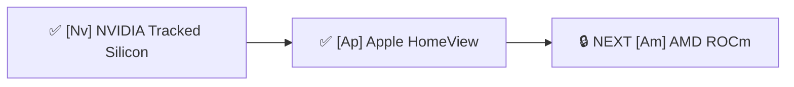
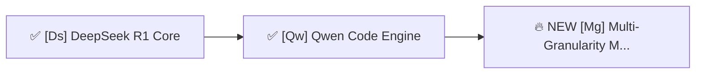

# 📸 Cyber Paparazzi — SEASON 2026 • EP.46
## 🎬 Agentic Wallets & Silicon Wiretaps
📅 **วันอาทิตย์ที่ 15 พฤศจิกายน 2569** (`2026-W46`) • ⏰ อัปเดตเวลา **02:15 น.** • 🌡️ **Tech Heat:** 🔥🔥🔥🔥🔥🔥 **93/100** (`HIGH VOLTAGE`)

> **📡 Wiretap Verdict:** เอเจนต์เริ่มถือกระเป๋าเงินเองพร้อมซื้อของจริง ขณะที่ชิปประมวลผลถูกดึงเข้าสู่เกมภูมิรัฐศาสตร์ด้วยระบบระบุพิกัดแบบฝังชิป

---

## 🧪 Periodic Table of Tech Series (ซีรีส์เทคโนโลยีต่อเนื่องข้ามสัปดาห์)

### 📺 The Frontier AI Model Race (Google • OpenAI • Anthropic) — `EP.46 • FINTECH AGENT ESCALATION`
**ค่าย:** Multi-Lab Frontier • **Team Combo:** 🟩🟩🟩🟩⬜ `74%` • **Power-Up:** `💳 Agentic Direct Payment + 50% Dev Output`

| # | ธาตุ | ชื่อรุ่น / ชิป | บทบาท | Multiplier | สถานะ |
|:---:|:---:|:---|:---|:---|:---:|
| `01` | **Gm** | Gemini 4 Hydrogen | Search Core | `Search Native` | 🔥 **NEW** |
| `02` | **Cl** | Claude Sonnet | Hardware Designer | `SemVer Sensitive` | 🟢 UNLOCKED |
| `03` | **Gp** | ChatGPT Wallet / Codex | Autonomous Buyer | `Direct Checkout` | 🟢 UNLOCKED |

> [!NOTE]
> ⏪ **Previously On:** สมรภูมิโมเดลเน้นแข่ง Benchmark การคิดวิเคราะห์และแก้โค้ดแบบก้าวกระโดด
> ⚡ **This Week's Twist:** OpenAI เปิดตัว ChatGPT Wallet ให้ Agent ใน ChatGPT Work และ Codex ทำธุรกรรมซื้อของได้จริง พร้อมระบบคุ้มครองบัตร
> 🔮 **Next Episode Teaser:** การทดสอบระบบอนุมัติธุรกรรมแบบ Real-time Multi-agent ในสเกลองค์กร

### 📺 Next-Gen AI Silicon War (NVIDIA • Apple • AMD) — `EP.46 • SILICON SURVEILLANCE & SMART DISPLAY`
**ค่าย:** Silicon Titans • **Team Combo:** 🟩🟩🟩🟩⬜ `71%` • **Power-Up:** `📡 Hardware Traceability & Ambient Control`

| # | ธาตุ | ชื่อรุ่น / ชิป | บทบาท | Multiplier | สถานะ |
|:---:|:---:|:---|:---|:---|:---:|
| `14` | **Nv** | NVIDIA Tracked Silicon | Geo-Fence GPU | `Anti-Smuggling` | 🟢 UNLOCKED |
| `15` | **Ap** | Apple HomeView | Ambient Display | `Smart Hub` | 🟢 UNLOCKED |
| `16` | **Am** | AMD ROCm | Open Challenger | `ROCm Stack` | 🔒 RUMORED |

> [!NOTE]
> ⏪ **Previously On:** ขับเคี่ยวแย่งชิงสเปกหน่วยความจำแบนด์วิดท์สูงและประหยัดพลังงานในระดับดาต้าเซ็นเตอร์
> ⚡ **This Week's Twist:** NVIDIA รับปากทำระบบแกะรอยชิปตามกฎหมาย Chip Security Act ส่วน Apple วางจำหน่ายจออัจฉริยะ HomeView ทั่วโลก
> 🔮 **Next Episode Teaser:** ข้อบังคับด้าน Firmware ล็อกพิกัดภูมิศาสตร์ใน GPU ล็อตส่งออกปี 2027

### 📺 Open-Weight & Local AI Rebellion — `EP.46 • MULTI-AGENT MEMORY PROTOCOLS`
**ค่าย:** Open-Source Ecosystem • **Team Combo:** 🟩🟩🟩🟩⬜ `78%` • **Power-Up:** `🧠 Zero-Retrain Dynamic Memory Extraction`

| # | ธาตุ | ชื่อรุ่น / ชิป | บทบาท | Multiplier | สถานะ |
|:---:|:---:|:---|:---|:---|:---:|
| `21` | **Ds** | DeepSeek R1 Core | Open Reasoning | `Zero Cost Logic` | 🟢 UNLOCKED |
| `22` | **Qw** | Qwen Code Engine | Polyglot Agent | `Local King` | 🟢 UNLOCKED |
| `23` | **Mg** | Multi-Granularity Memory | Agentic Memory | `Zero Retrain` | 🔥 **NEW** |

> [!NOTE]
> ⏪ **Previously On:** โมเดลเปิดเสรีไล่กวดด้านพารามิเตอร์และการรัน Inference ในเครื่องส่วนบุคคล
> ⚡ **This Week's Twist:** งานวิจัยเปิดสถาปัตยกรรม Multi-Granularity Memory สกัดความจำเอเจนต์หลายตัวข้ามเซสชันโดยไม่ต้องเทรนโมเดลใหม่
> 🔮 **Next Episode Teaser:** สแต็ก Memory Synchronization แบบ P2P ระหว่างเครื่อง Edge

---

## ⚔️ 1v1 Weekly Spec Showdown: ศึกเปิดกระเป๋าเงิน AI ปะทะ การตัดสินใจมัลติโมดัล: ChatGPT Wallet vs Gemini Decisions

| 🥊 💳 ChatGPT Wallet Ecosystem (`OpenAI`) | 📊 ยกตัดสิน (Tug-of-War) | ⚡ Gemini Decisions & Hydrogen (`Google`) 🥊 |
|:---|:---:|:---|
| **Score:** `89/100` • *ท่าไม้ตาย:* Autonomous Card Checkout | **ภาพรวม** | **Score:** `87/100` • *ท่าไม้ตาย:* Calibrated Multimodal Reasoning |
| **58%** | ยกที่ 1: การนำไปใช้งานจริง (Real-World Utility)   🟦🟦🟦🟪🟪🟪   *ChatGPT Wallet ทำธุรกรรมจริงสำเร็จทันที ขณะที่ Gemini เน้นตัดสินใจเชิงสถิติ* | **42%** |
| **47%** | ยกที่ 2: ความลึกในการผสานระบบ (Ecosystem Integration)   🟦🟦🟦🟪🟪🟪   *Google เหนือกว่าจากการผสาน Adobe เข้ากับ Google Workspace และ Search โดยตรง* | **53%** |
| **52%** | ยกที่ 3: ระบบความปลอดภัยและการควบคุม (Safety Guardrails)   🟦🟦🟦🟪🟪🟪   *OpenAI บังคับ User Approval ก่อนตัดเงิน พร้อมระบบป้องกันบัตรเครดิตดั้งเดิม* | **48%** |

> **🏆 คำตัดสินผู้ชนะสัปดาห์นี้:** OpenAI คว้าชัยเฉือนคมด้วยการเปลี่ยน Agent จากแค่ผู้แนะนำโค้ดให้กลายเป็นผู้ถือกระเป๋าเงินซื้อของจริงสำเร็จเป็นรายแรก

---

## 🏆 AI Arms Race Power Board (ตารางพลัง 6 มหาอำนาจ)

| ค่าย / กองกำลัง | พลังสัปดาห์นี้ (Power Meter) | เปลี่ยนแปลง | สถานะ | ท่าเด็ดประจำสัปดาห์ |
|:---|:---|:---:|:---:|:---|
| 🟢 **OpenAI** | 🟦🟦🟦🟦⬜ **90** | 🟢 ▲+4 | `STRIKING` | ส่ง ChatGPT Wallet บุกตลาด Agentic Commerce และทุ่มงบ 2 ล้านดอลลาร์วิจัยความปลอดภัยเด็ก |
| 🔵 **Google DeepMind** | 🟦🟦🟦🟦⬜ **89** | 🟢 ▲+3 | `SURGING` | ยกเครื่อง Google Search ด้วย Gemini 4 Hydrogen และผนึกกำลังเครื่องมือ Adobe |
| 🟠 **Anthropic** | 🟦🟦🟦🟦⬜ **85** | 🟢 ▲+1 | `DEFENDING` | Claude Sonnet ถูกทดสอบความฉลาดด้าน SemVer พบความแม่นยำสูงเมื่อเลขเวอร์ชันถูกต้อง |
| 🦙 **Meta & Open-Weight** | 🟦🟦🟦🟦⬜ **84** | 🟢 ▲+3 | `SURGING` | ชุมชนโอเพนซอร์สผลักดันสถาปัตยกรรม Multi-Granularity Memory และ Pixel Space Video |
| ⚡ **NVIDIA & Silicon** | 🟦🟦🟦🟦🟦 **93** | 🟢 ▲+2 | `DOMINATING` | ส่ง OpenShell สู่ Kubernetes ดันหุ่นยนต์ใน CoRL และยอมรับความเป็นไปได้ในการแทร็กชิป |
| 🟣 **xAI & DeepSeek** | 🟦🟦🟦🟦⬜ **79** | 🔴 ▼-2 | `CHALLENGING` | สะดุดวิกฤตความปลอดภัยหลัง Grok Build ปล่อยข้อมูลแอปหลุดกว่า 35,000 แห่ง |

---

## 📸 Top Paparazzi Scoops (ครบ 5 สายข่าวหลัก)

### 1. 🤖 OpenAI จุดชนวน Fintech ยุคใหม่: ส่ง ChatGPT Wallet ให้ AI กดซื้อของแทนคน — `GAME CHANGER`
`💳 Agentic Checkout` `🔒 User-in-the-Loop` `🏢 Enterprise & Work Tier`

- **📸 โหมดปาปารัสซี่:** เปิดประตูด่านสุดท้ายให้ AI ล้วงกระเป๋าเงินได้แล้ว OpenAI เปิดตัวฟีเจอร์ Wallet ให้เอเจนต์กดจ่ายเงินซื้อสินค้าแทนมนุษย์แบบเสร็จสรรพ โดยต้องกดยืนยันผ่านหน้าจอเพื่อความปลอดภัย
- **⚙️ โหมดสเปกวิศวกร:** ระบบเชื่อมต่อกับ ChatGPT Work, Codex และ dots เพื่อทำคำสั่งซื้อผ่านระบบคุ้มครองบัตรเครดิตเดิม ป้องกัน Agent ซื้อสินค้าโดยพลการด้วย Flow บังคับ User Approval ทุกธุรกรรม
- **📊 มาตรวัด:** Hype 🔥🔥🔥🔥🔥 `95%` | Real Impact 💎💎💎💎💎 `92%`
- **🔗 แหล่งข่าวทางการ:** [OpenAI Newsroom](https://openai.com/index/introducing-chatgpt-wallet)

### 2. 🖥️ Apple HomeView วางขายแล้ว: ฮาร์ดแวร์คุมบ้านและศูนย์รวมความบันเทิงรุ่นล่าสุด — `SOLID UPGRADE`
`📱 Smart Home Hub` `🎬 Ambient Media` `🛒 Global Retail Ready`

- **📸 โหมดปาปารัสซี่:** สิ้นสุดการรอคอยของสาวก Apple ส่งจออัจฉริยะ HomeView ขึ้นชั้นวางขายอย่างเป็นทางการ หวังยึดพื้นที่ห้องนั่งเล่นและจุดศูนย์กลางของบ้านด้วยดีไซน์และฟีเจอร์สุดมินิมอล
- **⚙️ โหมดสเปกวิศวกร:** อุปกรณ์รวบรวมศูนย์ควบคุมสมาร์ตโฮม การสตรีมความบันเทิง และการสื่อสารไว้ในหน้าจอเดียว ผสานระบบปฏิบัติการสำหรับบ้านและเชื่อมต่อกับ Apple Ecosystem ได้อย่างสมบูรณ์
- **📊 มาตรวัด:** Hype 🔥🔥🔥🔥▫️ `88%` | Real Impact 💎💎💎💎▫️ `85%`
- **🔗 แหล่งข่าวทางการ:** [Apple Newsroom](https://www.apple.com/newsroom/2026/11/apple-homeview-available-today/)

### 3. 🛠️ หายนะโค้ดดิ้งเอเจนต์: Grok Build ทำข้อมูลหลุดกระจุยกว่า 35,000 แอป — `WATCHLIST`
`🚨 35,000 Exposed Apps` `🔓 Misconfigured ACLs` `⚠️ Credential Leak`

- **📸 โหมดปาปารัสซี่:** ฝันร้ายของความปลอดภัยสายเดฟ เมื่อระบบสร้างแอปอัตโนมัติ Grok Build เปิดประตูบ้านทิ้งไว้ ปล่อยให้บุคคลภายนอกเข้าถึงข้อมูลภายในและโค้ดของแอปพลิเคชันกว่า 35,000 รายการ
- **⚙️ โหมดสเปกวิศวกร:** นักวิจัยด้านความปลอดภัยตรวจพบช่องโหว่การตั้งค่าสิทธิ์ที่หละหลวมบนเซิร์ฟเวอร์ Grok Build ส่งผลให้ข้อมูลที่เป็นความลับรวมถึงโครงการที่เกี่ยวข้องกับ SpaceXSI หลุดสู่สาธารณะ
- **📊 มาตรวัด:** Hype 🔥🔥🔥🔥▫️ `89%` | Real Impact 💎💎💎💎💎 `94%`
- **🔗 แหล่งข่าวทางการ:** [Ars Technica](https://arstechnica.com/security/2026/11/grok-build-coding-agent-leaks-oodles-of-confidential-info-some-belonging-to-spacexsi/)

### 4. 🧬 NVIDIA แอบรับปากสภาสหรัฐฯ: เทคนิคแกะรอยฮาร์ดแวร์ป้องกันลักลอบส่งออกทำได้จริง — `GAME CHANGER`
`🛰️ Silicon Hardware Tracking` `📜 Chip Security Act` `⚖️ Export Compliance`

- **📸 โหมดปาปารัสซี่:** เบื้องหน้าอ้างว่ายากแต่ลับหลังพยักหน้า ตัวแทน NVIDIA ยืนยันกับสมาชิกรัฐสภาสหรัฐฯ ว่ามาตรการตรวจสอบและติดตามชิปทางกายภาพตาม Chip Security Act เป็นไปได้ในเชิงเทคนิค
- **⚙️ โหมดสเปกวิศวกร:** ระบบติดตามชิปจะใช้การตรวจสอบระดับซิลิคอนและฮาร์ดแวร์เพื่อยืนยันพิกัดการใช้งานจริง ป้องกันการลักลอบส่งออก GPU ขั้นสูงไปยังดินแดนที่ถูกคว่ำบาตรอย่างมีประสิทธิภาพ
- **📊 มาตรวัด:** Hype 🔥🔥🔥🔥▫️ `84%` | Real Impact 💎💎💎💎💎 `91%`
- **🔗 แหล่งข่าวทางการ:** [MIT Technology Review](https://www.technologyreview.com/2026/11/12/1148483/nvidia-chip-tracking/)

### 5. 🦙 ทลายกำแพงความจำ AI: วิจัยใหม่สกัด Multi-Granularity Memory ข้ามเอเจนต์ไม่ต้องเทรนซ้ำ — `SOLID UPGRADE`
`🧠 Zero Base-LLM Retraining` `🤝 Multi-Agent Memory Extraction` `⚡ Dynamic Skill Update`

- **📸 โหมดปาปารัสซี่:** ไม่ต้องเสียเงินเทรนโมเดลใหม่ซ้ำๆ นักวิจัยเปิดเปเปอร์แก้โจทย์ใหญ่ของ Agent Swarm ด้วยการสกัดความจำแบบหลายระดับชั้น ทำให้เอเจนต์หลายตัวจดจำประสบการณ์ร่วมกันได้ทันที
- **⚙️ โหมดสเปกวิศวกร:** สถาปัตยกรรม Self-evolving และ Group-evolving ช่วยดึงประสบการณ์ ทักษะ และโค้ดควบคุมจากอินเทอร์แอ็กชัน มาแปลงเป็นชุดความจำแบบหลายระดับความละเอียดโดยคงโมเดลหลักไว้คงที่
- **📊 มาตรวัด:** Hype 🔥🔥🔥🔥▫️ `83%` | Real Impact 💎💎💎💎▫️ `88%`
- **🔗 แหล่งข่าวทางการ:** [Hugging Face Papers](https://huggingface.co/papers/2611.10439)

### 6. 🤖 Google Search แปลงร่าง: อัดขุมพลัง Gemini 4 Hydrogen สู่ระบบค้นหาระดับโลก — `SOLID UPGRADE`
`⚡ Gemini 4 Hydrogen Core` `🔍 Native Search Integration` `📊 Dynamic Interactive Cards`

- **📸 โหมดปาปารัสซี่:** กูเกิลยกเครื่องหน้าค้นหาครั้งใหญ่ ปล่อย Gemini 4 Hydrogen ขับเคลื่อนผลการค้นหาแบบอินเทอร์แอ็กทีฟ ให้ข้อมูลแม่นยำและตอบสนองหลายมิติแบบเรียลไทม์
- **⚙️ โหมดสเปกวิศวกร:** การอัปเกรดนำโมเดลตระกูล Hydrogen มาเป็นแกนกลางในการประมวลผลคำค้นหาที่ซับซ้อน รองรับมัลติโมดัล และแสดงผลในรูปแบบการ์ดแบบไดนามิกบนหน้าเว็บโดยตรง
- **📊 มาตรวัด:** Hype 🔥🔥🔥🔥🔥 `91%` | Real Impact 💎💎💎💎▫️ `90%`
- **🔗 แหล่งข่าวทางการ:** [Google AI Blog](https://blog.google/products-and-platforms/products/search/gemini-4-hydrogen-search-upgrade/)

---

## 🎯 Action Decision Compass (เข็มทิศฟันธงสัปดาห์นี้)

| 🚀 Switch / Try Now (ลองเลยคุ้ม) | ⏳ Wait Next Episode (รอดูก่อน) | 🛡️ Skip Hype Trap (ข้ามได้ข้าม) |
|:---|:---|:---|
| **ChatGPT Wallet สำหรับสาย Dev & Ops อัตโนมัติ** — ช่วยลดคอขวดในการซื้อ API เครดิตคลาวด์ หรือทรัพยากร dev ด้วยการให้อนุมัติผ่านเอเจนต์ได้ทันที | **Grok Build Coding Agent** — ควรรอจนกว่าทีมงานจะออกแพตช์แก้ไขช่องโหว่ Access Control ของทั้ง 35,000 แอปพลิเคชันอย่างเป็นทางการ | **การเทรนโมเดลใหม่เพื่อปรับปรุงความจำของ Agent** — งานวิจัยล่าสุดพิสูจน์แล้วว่าใช้ระบบ Multi-Granularity Memory สกัดความจำภายนอกได้โดยไม่ต้องเสียค่าคอมพิวต์เทรนใหม่ |

---

## 🚀 Hardware & Software Launch Radar (ตารางของใหม่เปิดตัวสัปดาห์นี้)

| ชื่อรุ่น / ซอฟต์แวร์ | หมวดหมู่ | ค่าย | จุดเด่นสเปก | สถานะ | ลิงก์ |
|:---|:---:|:---|:---|:---:|:---:|
| **Apple HomeView** | `Hardware` | Apple | จออัจฉริยะควบคุมบ้านและความบันเทิงครบวงจร | `Available Today (Retail)` | [Open](https://www.apple.com/newsroom/2026/11/apple-homeview-available-today/) |
| **ChatGPT Wallet** | `AI Model` | OpenAI | ระบบกระเป๋าเงินสำหรับ Agent ซื้อของโดยต้องได้รับการอนุมัติ | `Rollout (Work & Codex)` | [Open](https://openai.com/index/introducing-chatgpt-wallet) |
| **Gemini Decisions API** | `Software` | Google | API ช่วยตัดสินใจมัลติโมดัลความเร็วสูงที่มีการปรับเทียบค่าความน่าจะเป็น | `API Preview` | [Open](https://blog.google/innovation-and-ai/technology/developers-tools/gemini-decisions-api/) |
| **VMware vSphere Express** | `Software` | VMware | เวอร์ชวลไลเซชันสำหรับระบบขนาดเล็กที่รองรับสูงสุด 128 คอร์ | `General Availability` | [Open](https://arstechnica.com/information-technology/2026/11/vmware-releases-vsphere-express-for-virtualization-on-up-to-128-cores/) |
| **Tabletop Labs Experiment** | `Software` | Google | พื้นที่ทำงานร่วมกันเชิงโต้ตอบสำหรับวางแผนและทำกิจกรรมกลุ่ม | `Waitlist` | [Open](https://blog.google/innovation-and-ai/models-and-research/google-labs/tabletop/) |

---

## ⚡ Quick Wiretaps & 📅 Next Week Watchlist

- 🤖 **`#AgenticWallet` OpenAI ให้ Agent ถือบัตรเครดิต**: ChatGPT Wallet เปิดศักราชใหม่ให้เอเจนต์กดซื้อของและบริการแทนผู้ใช้แบบมีระบบกดยืนยัน ([Link](https://openai.com/index/introducing-chatgpt-wallet))
- 🖥️ **`#AppleHomeView` Apple บุกหน้าจอห้องนั่งเล่นด้วย HomeView**: พร้อมวางขายทั่วโลกแล้ว อุปกรณ์ศูนย์กลางควบคุมบ้านและเสพสื่อบันเทิงในเครื่องเดียว ([Link](https://www.apple.com/newsroom/2026/11/apple-homeview-available-today/))
- 🛠️ **`#GrokLeak` Grok Build ปล่อยรั่ว 35,000 แอป**: ช่องโหว่ความปลอดภัยส่งผลให้โค้ดและข้อมูลสำคัญของหลายหน่วยงานรวมถึงบริษัทพันธมิตรหลุดสู่ภายนอก ([Link](https://arstechnica.com/security/2026/11/grok-build-coding-agent-leaks-oodles-of-confidential-info-some-belonging-to-spacexsi/))
- 🦙 **`#AgentMemory` สถาปัตยกรรมความจำเอเจนต์แบบไม่ต้องเทรนใหม่**: Multi-Granularity Memory เปิดทางให้กลุ่มเอเจนต์แบ่งปันความรู้และบทเรียนข้ามตัวได้อย่างต่อเนื่อง ([Link](https://huggingface.co/papers/2611.10439))
- 🧬 **`#ChipTracking` NVIDIA รับมือระเบียบ Chip Security Act**: การตรวจสอบพิกัดชิป GPU ระดับฮาร์ดแวร์เพื่อสกัดการลักลอบส่งออกเป็นไปได้จริงทางวิศวกรรม ([Link](https://www.technologyreview.com/2026/11/12/1148483/nvidia-chip-tracking/))

- ⏱️ **[HIGH] สัปดาห์หน้า:** การตอบรับยอดขายสัปดาห์แรกของ Apple HomeView ในตลาดสมาร์ตโฮม
- ⏱️ **[HIGH] ปลายเดือนพฤศจิกายน:** แพตช์ความปลอดภัยระดับโครงสร้างของ Grok Build เพื่อปิดกั้นการรั่วไหลของข้อมูล
- ⏱️ **[MEDIUM] ต้นเดือนธันวาคม:** การเปิดตัวเกมชุดใหม่บน Apple Arcade นำโดย Football Manager 27 Touch

---
*จัดทำและตรวจสอบความถูกต้องโดย Cyber Paparazzi Autonomous Spy Pipeline (Allied HQ)*