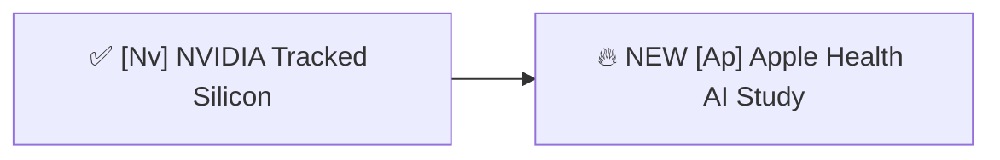

# 📸 Cyber Paparazzi — SEASON 2026 • EP.47
## 🎬 GPT-6 Astra & Quantum Proofs: ชิประเบิด สปายป่วน วงการ AI เดือด
📅 **วันจันทร์ที่ 16 พฤศจิกายน 2569** (`2026-W47`) • ⏰ อัปเดตเวลา **09:16 น.** • 🌡️ **Tech Heat:** 🔥🔥🔥🔥🔥🔥 **92/100** (`CODE RED`)

> **📡 Wiretap Verdict:** สัปดาห์นี้โลก AI สั่นสะเทือนด้วยการพิสูจน์ฟิสิกส์ระดับทฤษฎีจาก GPT-6 Astra ผสมดราม่าชิป NVIDIA และช่องโหว่ความปลอดภัยไซเบอร์ระดับวิกฤต

---

## 🧪 Periodic Table of Tech Series (ซีรีส์เทคโนโลยีต่อเนื่องข้ามสัปดาห์)

### 📺 The Frontier AI Model Race (Google • OpenAI • Anthropic) — `EP.47 • QUANTUM SCIENCE & ELECTRONIC DESIGN`
**ค่าย:** Multi-Lab Frontier • **Team Combo:** 🟩🟩🟩🟩⬜ `79%` • **Power-Up:** `⚛️ Scientific Proofs & Electronic Hardware Automation`

| # | ธาตุ | ชื่อรุ่น / ชิป | บทบาท | Multiplier | สถานะ |
|:---:|:---:|:---|:---|:---|:---:|
| `01` | **Gm** | Gemini 4 Hydrogen | Agentic Workflows | `Search Native` | 🟢 UNLOCKED |
| `02` | **Cl** | Claude Electronics Engine | Hardware Designer | `Full PCB Design` | 🔥 **NEW** |
| `04` | **As** | GPT-6 Astra | Quantum Theorist | `Standard Model` | 🔥 **NEW** |

> [!NOTE]
> ⏪ **Previously On:** OpenAI จุดชนวนระบบการเงิน Agentic Payments ด้วย ChatGPT Wallet ในสัปดาห์ก่อน
> ⚡ **This Week's Twist:** OpenAI เผย GPT-6 Astra ช่วยคิดและพิสูจน์ทฤษฎีทางฟิสิกส์ระดับ Standard Model ขณะที่ Claude สามารถออกแบบต้นแบบอิเล็กทรอนิกส์ได้แบบครบวงจร
> 🔮 **Next Episode Teaser:** การเปิดตัวโมเดลสายวิทยาศาสตร์บริสุทธิ์เพื่อเร่งการค้นพบยาและวัสดุศาสตร์

### 📺 Next-Gen AI Silicon War (NVIDIA • Apple • AMD) — `EP.47 • GEOPOLITICAL SPY & AI HEALTH STUDY`
**ค่าย:** Silicon Titans • **Team Combo:** 🟩🟩🟩🟩⬜ `75%` • **Power-Up:** `🏥 Health Conversational AI & Strict Geo-Export Rules`

| # | ธาตุ | ชื่อรุ่น / ชิป | บทบาท | Multiplier | สถานะ |
|:---:|:---:|:---|:---|:---|:---:|
| `14` | **Nv** | NVIDIA Tracked Silicon | Geo-Fence GPU | `Export Restricted` | 🟢 UNLOCKED |
| `17` | **Ap** | Apple Health AI Study | Clinical Intelligence | `Virtual Study` | 🔥 **NEW** |

> [!NOTE]
> ⏪ **Previously On:** NVIDIA รับปากทำระบบแกะรอยฮาร์ดแวร์เพื่อป้องกันการลักลอบส่งออกชิป
> ⚡ **This Week's Twist:** สภาสหรัฐฯ เตรียมยึดกฎคุมเข้มส่งออกชิป AI หลังดราม่า Jensen Huang และสายลับจีน ส่วน Apple เปิดการศึกษาวิจัย AI เพื่อสุขภาพ
> 🔮 **Next Episode Teaser:** มาตรการล็อกระดับเฟิร์มแวร์ในชิปประมวลผลรุ่นถัดไปตามข้อกำหนดความมั่นคง

### 📺 Open-Weight & Local AI Rebellion — `EP.47 • ADAPTIVE REASONING & HYBRID MODELS`
**ค่าย:** Open-Source Ecosystem • **Team Combo:** 🟩🟩🟩🟩⬜ `82%` • **Power-Up:** `💡 Dynamic Reasoning Token Optimization`

| # | ธาตุ | ชื่อรุ่น / ชิป | บทบาท | Multiplier | สถานะ |
|:---:|:---:|:---|:---|:---|:---:|
| `24` | **Vt** | Value-of-Thinking Core | Hybrid Decision | `Selective Reasoning` | 🔥 **NEW** |

> [!NOTE]
> ⏪ **Previously On:** วงการวิจัยเปิดสถาปัตยกรรม Multi-Granularity Memory สำหรับเอเจนต์
> ⚡ **This Week's Twist:** งานวิจัยใหม่ The Value of Thinking นำเสนอการเรียนรู้ว่าเมื่อไหร่ควรใช้เหตุผลในโมเดลไฮบริดโดยไม่ต้องสร้างโทเคนฟุ่มเฟือย
> 🔮 **Next Episode Teaser:** การรันโมเดลไฮบริดแบบปรับการคิดตามความยากบนฮาร์ดแวร์ขอบแดน

---

## ⚔️ 1v1 Weekly Spec Showdown: Frontier Science Reasoning vs Autonomous Hardware Design

| 🥊 ⚛️ GPT-6 Astra (Standard Model Proof) (`OpenAI`) | 📊 ยกตัดสิน (Tug-of-War) | 🔌 Claude Electronics Engine (`Anthropic`) 🥊 |
|:---|:---:|:---|
| **Score:** `94/100` • *ท่าไม้ตาย:* การพิสูจน์ฟิสิกส์ทฤษฎีบน Lattice | **ภาพรวม** | **Score:** `91/100` • *ท่าไม้ตาย:* การออกแบบวงจรอิเล็กทรอนิกส์ครบวงจร |
| **60%** | ยกที่ 1: ความซับซ้อนของตรรกะ (Logic & Reasoning)   🟦🟦🟦🟦🟪🟪   *Astra โชว์ศักยภาพการคิดระดับฟิสิกส์ทฤษฎีเบื้องลึก* | **40%** |
| **45%** | ยกที่ 2: การนำไปประยุกต์ใช้ในอุตสาหกรรม (Practical Utility)   🟦🟦🟦🟪🟪🟪   *Claude ออกแบบวงจรอิเล็กทรอนิกส์นำไปผลิตจริงได้ทันที* | **55%** |
| **58%** | ยกที่ 3: ผลกระทบต่อวงการวิทยาศาสตร์ (Scientific Impact)   🟦🟦🟦🟪🟪🟪   *การสร้างบล็อกวิทยาศาสตร์ใหม่ของ OpenAI ปักหมุด AI เพื่อการค้นพบ* | **42%** |

> **🏆 คำตัดสินผู้ชนะสัปดาห์นี้:** GPT-6 Astra คว้าชัยชนะสัปดาห์นี้ไปอย่างเฉียบขาด ด้วยการก้าวข้ามจากการเขียนโค้ดธรรมดาไปสู่การสกัดทฤษฎีทางฟิสิกส์ขั้นสูง

---

## 🏆 AI Arms Race Power Board (ตารางพลัง 6 มหาอำนาจ)

| ค่าย / กองกำลัง | พลังสัปดาห์นี้ (Power Meter) | เปลี่ยนแปลง | สถานะ | ท่าเด็ดประจำสัปดาห์ |
|:---|:---|:---:|:---:|:---|
| 🟢 **OpenAI** | 🟦🟦🟦🟦🟦 **93** | 🟢 ▲+5 | `SURGING` | ปล่อย GPT-6 Astra ช่วยงานวิจัยฟิสิกส์ทฤษฎีระดับโลก |
| 🔵 **Google DeepMind** | 🟦🟦🟦🟦⬜ **88** | 🟢 ▲+2 | `DEFENDING` | ขยาย Gemini 4 Hydrogen สู่ระบบงานเอเจนต์ระดับองค์กร |
| 🟠 **Anthropic** | 🟦🟦🟦🟦⬜ **89** | 🟢 ▲+4 | `STRIKING` | เปิดความสามารถ Claude ออกแบบวงจรอิเล็กทรอนิกส์ |
| 🦙 **Meta & Open-Weight** | 🟦🟦🟦🟦⬜ **81** | 🟢 ▲+2 | `STEALTH` | พัฒนางานวิจัยการคิดแบบไฮบริด Value of Thinking |
| ⚡ **NVIDIA & Silicon** | 🟦🟦🟦🟦⬜ **89** | 🔴 ▼-3 | `DEFENDING` | เผชิญแรงกดดันจากสภาสหรัฐฯ เรื่องกฎหมายส่งออกชิป |
| 🟣 **xAI & DeepSeek** | 🟦🟦🟦🟦⬜ **80** | 🟢 ▲+1 | `CHALLENGING` | รักษาฐานตลาดโมเดลประหยัดต้นทุน Inference |

---

## 📸 Top Paparazzi Scoops (ครบ 5 สายข่าวหลัก)

### 1. 🤖 GPT-6 Astra ทะลายพรมแดนฟิสิกส์: ช่วยพิสูจน์ Standard Model บน Lattice — `GAME CHANGER`
`⚛️ Standard Model` `📜 Lattice Proofs` `🔬 OpenAI Science`

- **📸 โหมดปาปารัสซี่:** สายสืบดักจับข้อมูลสุดช็อก! OpenAI ไม่ได้แค่อัปเดตแชตบอต แต่ปล่อย GPT-6 Astra เข้าไปลุยงานฟิสิกส์ทฤษฎีขั้นสูง ร่วมสกัดบทพิสูจน์ทฤษฎีอนุภาคแบบนอนเพอร์เทอร์เบทีฟจนนักวิทยาศาสตร์ต้องตะลึง!
- **⚙️ โหมดสเปกวิศวกร:** OpenAI ตีพิมพ์ผลงานวิจัยการใช้โมเดล Astra ช่วยสร้างบทพิสูจน์ Candidate nonperturbative lattice definition ของ Standard Model ได้สำเร็จ แสดงถึงความสามารถด้านสัญลักษณ์และการประมวลผลตรรกะระดับสูง
- **📊 มาตรวัด:** Hype 🔥🔥🔥🔥🔥 `95%` | Real Impact 💎💎💎💎💎 `92%`
- **🔗 แหล่งข่าวทางการ:** [OpenAI Newsroom](https://openai.com/index/step-toward-defining-the-standard-model)

### 2. 🖥️ สภาสหรัฐฯ เดือด! จ่อล้างไพ่กฎส่งออกชิป AI หลังดราม่า Jensen Huang — `GAME CHANGER`
`🛡️ Export Controls` `⚖️ Congressional Action` `🔍 Chip Tracking`

- **📸 โหมดปาปารัสซี่:** สลายมโนสายลักลอบ! หลังมีข่าวลือสปายและมรสุมของอดีต CEO NVIDIA สภาคองเกรสเตรียมงัดมาตรการคุมเข้มส่งออก GPU ขั้นสูงสุด งานนี้ส่งผลกระทบต่อห่วงโซ่อุปทานเทคทั่วโลก!
- **⚙️ โหมดสเปกวิศวกร:** สมาชิกสภาสหรัฐฯ ทั้งสองพรรคผลักดันกฎระเบียบส่งออกชิป AI ที่เข้มงวดขึ้น ครอบคลุมการแกะรอยฮาร์ดแวร์ การยืนยันตำแหน่งทางภูมิศาสตร์ และการจำกัดการเข้าถึงเทคโนโลยีพรีเมียม
- **📊 มาตรวัด:** Hype 🔥🔥🔥🔥▫️ `88%` | Real Impact 💎💎💎💎▫️ `90%`
- **🔗 แหล่งข่าวทางการ:** [The Verge](https://www.theverge.com/ai-artificial-intelligence/1033984/congress-export-rules-ai-chips-china)

### 3. 🛠️ ศึก SemVer ของ AI Coding Agents: Claude Sonnet 5.5 สอบผ่าน หรือตาบอดกับเลขเวอร์ชัน? — `SOLID UPGRADE`
`📊 1,000 Runs Test` `🏷️ SemVer Sensitivity` `🐛 Code Integrity`

- **📸 โหมดปาปารัสซี่:** อย่าเพิ่งไว้ใจเอเจนต์เขียนโค้ด! ทีมวิจัย Microsoft จับเอเจนต์รันสอบ 1,000 ครั้ง พบว่าหากใส่เลข Breaking Upgrade เป็น 2.0.0 โมเดลอย่าง Claude Sonnet 5.5 จะตรวจเช็กถูกต้องครบ 100% แต่ถ้าเนียนใช้ 1.4.3 กลับปล่อยผ่านจนแอปพัง!
- **⚙️ โหมดสเปกวิศวกร:** Microsoft DevBlogs เผยผลทดสอบ SemVer กับ AI Coding Agents ชี้ให้เห็นว่าโมเดลอิงตาม Semantic Versioning ตัวเลขหลักอย่างรุนแรง หากเวอร์ชันไม่สะท้อนการเปลี่ยนแปลง breaking changes เอเจนต์อาจล้มเหลวในการตรวจสอบความปลอดภัยของโค้ด
- **📊 มาตรวัด:** Hype 🔥🔥🔥🔥▫️ `84%` | Real Impact 💎💎💎💎▫️ `89%`
- **🔗 แหล่งข่าวทางการ:** [Microsoft DevBlogs](https://devblogs.microsoft.com/blog/do-ai-coding-agents-care-about-semver/)

### 4. 🦙 The Value of Thinking: โมเดลไฮบริดคิดก่อนตอบ เลิกเปลืองโทเคนโดยไม่จำเป็น — `SOLID UPGRADE`
`🧠 Adaptive Reasoning` `📉 Token Efficiency` `⚡ Dynamic Thinking`

- **📸 โหมดปาปารัสซี่:** สายเปิดเสรีได้เฮ! งานวิจัยใหม่ประเมินคุณค่าของการใช้เหตุผล (Reasoning) ช่วยให้โมเดลตัดสินใจได้ว่า 'เมื่อไหร่ควรคิด' และ 'เมื่อไหร่ควรตอบทันที' ไม่ต้องเสียเวลาเจเนอเรตโทเคนความคิดยาวเหยียดอีกต่อไป!
- **⚙️ โหมดสเปกวิศวกร:** งานวิจัยบน Hugging Face นำเสนอเฟรมเวิร์กการตัดสินใจแบบไฮบริดที่เลือกระดับการประมวลผลตรรกะตามความซับซ้อนของโจทย์ ช่วยลด Latency และต้นทุนการรัน Inference ในฮาร์ดแวร์ท้องถิ่นได้อย่างมีประสิทธิภาพ
- **📊 มาตรวัด:** Hype 🔥🔥🔥🔥▫️ `82%` | Real Impact 💎💎💎💎▫️ `86%`
- **🔗 แหล่งข่าวทางการ:** [Hugging Face Papers](https://huggingface.co/papers/2611.16961)

### 5. 🧬 ผ่าวิกฤตความปลอดภัย: ช่องโหว่ SignDrop บน Windows ให้สิทธิ์ System แฮกเกอร์รุมยึดเครื่อง — `GAME CHANGER`
`🚨 0-Day Vulnerability` `🔑 Privilege Escalation` `🛡️ Windows Security`

- **📸 โหมดปาปารัสซี่:** เตือนภัยระดับสีแดง! นักวิจัยหัวเสียปล่อยช่องโหว่ 0-day รหัส SignDrop บน Windows ที่เปิดทางให้ผู้ใช้ระดับ Local สวมรอยยึดสิทธิ์ System สูงสุดอย่างง่ายดาย ต้องรีบแพตช์ด่วน!
- **⚙️ โหมดสเปกวิศวกร:** การค้นพบการโจมตี Local Privilege Escalation (LPE) ผ่าน SignDrop บนระบบปฏิบัติการ Windows ช่วยให้ผู้บุกรุกเปลี่ยนสิทธิ์จากผู้ใช้ทั่วไปไปสู่ระดับ NT AUTHORITY\SYSTEM ได้โดยตรง
- **📊 มาตรวัด:** Hype 🔥🔥🔥🔥▫️ `90%` | Real Impact 💎💎💎💎💎 `94%`
- **🔗 แหล่งข่าวทางการ:** [Ars Technica](https://arstechnica.com/security/2026/11/windows-0-day-dropped-by-disgruntled-researcher-hands-hackers-system-rights/)

### 6. 🛠️ Gemini 4 Hydrogen ขยายทัพ: อัดขุมพลังเอเจนต์เข้าสู่ระบบงานองค์กร — `SOLID UPGRADE`
`🤖 Agentic Workflow` `🌐 Enterprise Integration` `⚡ Hydrogen Engine`

- **📸 โหมดปาปารัสซี่:** Google สู้ไม่ถอย! เปิดตัว Gemini 4 Hydrogen ออกแบบมาเพื่อ Agentic Workflows โดยเฉพาะ พร้อมเชื่อมต่อระบบการทำงานและคำสั่งอัตโนมัติแบบไร้รอยต่อ!
- **⚙️ โหมดสเปกวิศวกร:** Google ประกาศเปิดตัวโมเดลตระกูล Gemini 4 Hydrogen ที่เน้นการทำงานร่วมกับเวิร์กโฟลว์ของเอเจนต์ รองรับการเรียกใช้ Tool Use ขั้นสูงและการประมวลผลคำสั่งแบบต่อเนื่อง
- **📊 มาตรวัด:** Hype 🔥🔥🔥🔥▫️ `86%` | Real Impact 💎💎💎💎▫️ `87%`
- **🔗 แหล่งข่าวทางการ:** [Google AI Blog](https://news.google.com/rss/articles/CBMipAFBVV95cUxNbnlqelBIT1ZXblFBa25zdHlXalhPR2Z2b2xLZ2lmeEtFbUFXS3Mya3FtU0tyeGJrOXpHVEJOdFpDVUZSUTVOUHA0WjRiakw2a2hIRzc3ZHBfM3pDT3dKTDdfMExNQ2FnU1NWSHI3UGpXX2lVSEUxeVYwb2FfNE5vRGJnMjhWSzU5WkFrdmtOdW5Fb0lja1dFN3JUMkQ5R01JRXhNUA?oc=5)

---

## 🎯 Action Decision Compass (เข็มทิศฟันธงสัปดาห์นี้)

| 🚀 Switch / Try Now (ลองเลยคุ้ม) | ⏳ Wait Next Episode (รอดูก่อน) | 🛡️ Skip Hype Trap (ข้ามได้ข้าม) |
|:---|:---|:---|
| **อัปเดตระบบปฏิบัติการ Windows และแพตช์ความปลอดภัย Git** — ป้องกันการโจมตีจากช่องโหว่ SignDrop และช่องโหว่การทำ Clone ใน Git | **การซื้ออุปกรณ์ประมวลผลชิป GPU ล็อตใหม่** — รอดูทิศทางข้อบังคับการส่งออกชิปฉบับใหม่จากสภาคองเกรส | **การปล่อยให้ AI Agent ทำ Breaking Upgrade อัตโนมัติโดยไม่กำกับ SemVer 2.0.0** — เอเจนต์อาจมองข้าม Breaking Changes หากเลขเวอร์ชันเปลี่ยนแบบ Minor |

---

## 🚀 Hardware & Software Launch Radar (ตารางของใหม่เปิดตัวสัปดาห์นี้)

| ชื่อรุ่น / ซอฟต์แวร์ | หมวดหมู่ | ค่าย | จุดเด่นสเปก | สถานะ | ลิงก์ |
|:---|:---:|:---|:---|:---:|:---:|
| **Gemini 4 Hydrogen** | `AI Model` | Google | ปรับแต่งเพื่อ Agentic Workflows และ Multi-Tool Use | `API` | [Open](https://news.google.com/rss/articles/CBMipAFBVV95cUxNbnlqelBIT1ZXblFBa25zdHlXalhPR2Z2b2xLZ2lmeEtFbUFXS3Mya3FtU0tyeGJrOXpHVEJOdFpDVUZSUTVOUHA0WjRiakw2a2hIRzc3ZHBfM3pDT3dKTDdfMExNQ2FnU1NWSHI3UGpXX2lVSEUxeVYwb2FfNE5vRGJnMjhWSzU5WkFrdmtOdW5Fb0lja1dFN3JUMkQ5R01JRXhNUA?oc=5) |
| **Claude Electronics Design Capabilities** | `AI Model Feature` | Anthropic | ออกแบบวงจรอิเล็กทรอนิกส์และต้นแบบฮาร์ดแวร์ตั้งแต่ต้นจนจบ | `Beta` | [Open](https://news.google.com/rss/articles/CBMibEFVX3lxTFBCTmk0c0tyNmVjUlFGNGlCZUtLSkxDQS13Unc1LUVXanhOVmt2a2xTLUQ2Vm5LZ2RLQnMzVUhUQXFLTVBfd1VQZi01V0ppVkZLU0VIcXNJT3V3Ul9ZSEFUS3l6S2ZLY0tHOVgxNw?oc=5) |
| **Apple Health AI Usage Study App** | `Software` | Apple | แพลตฟอร์มวิจัยการปฏิสัมพันธ์ระหว่างผู้ใช้กับ AI ด้านสุขภาพ | `Pre-order` | [Open](https://www.apple.com/newsroom/2026/11/apple-launches-research-study-to-explore-the-use-of-ai-for-health/) |

---

## ⚡ Quick Wiretaps & 📅 Next Week Watchlist

- 🤖 **`#ScientificAI` OpenAI เปิดตัวบล็อกสำหรับงานวิจัยวิทยาศาสตร์โดยเฉพาะ**: มุ่งเป้าเร่งการค้นพบทางวิทยาศาสตร์ผ่านพลังของปัญญาประดิษฐ์ ([Link](https://openai.com/index/our-new-blog-for-science))
- 🖥️ **`#AppleHealth` Apple เริ่มต้นโครงการศึกษาวิจัยการใช้ AI ในการดูแลสุขภาพ**: สำรวจประสิทธิภาพและการตอบสนองของ Conversational AI กับผู้ป่วยจริง ([Link](https://www.apple.com/newsroom/2026/11/apple-launches-research-study-to-explore-the-use-of-ai-for-health/))
- 🛠️ **`#AgenticEng` GitHub ดันแนวทาง Agentic Engineering ข้ามขั้นการสร้างโค้ด**: ขยายบทบาท Copilot ครอบคลุมการวางแผน รีวิว และแก้ปัญหา Production ([Link](https://github.blog/ai-and-ml/github-copilot/beyond-code-generation-a-developers-guide-to-agentic-engineering/))
- 🦙 **`#EmbodiedAI` EgoX นำเสนอการควบคุมหุ่นยนต์ข้ามรูปแบบด้วย Embodiment Dreaming**: ผสานประสบการณ์มนุษย์และหุ่นยนต์จำลองเพื่อสร้างนโยบายการจัดการอเนกประสงค์ ([Link](https://huggingface.co/papers/2611.16728))
- 🧬 **`#BrainImplants` ผู้ร่วมทดสอบชิปฝองในสมองเรียกร้องอิสรภาพและลดสัญญา NDA**: อาสาสมัครต้องการสิทธิ์ในการสั่งการและเปิดเผยประสบการณ์ใช้งานจริง ([Link](https://www.technologyreview.com/2026/11/13/1148474/more-autonomy-fewer-ndas-volunteers-have-new-requests-for-brain-implant-trials/))

- ⏱️ **[HIGH] สัปดาห์หน้า:** การประกาศมาตรการคุมเข้มส่งออกชิป AI ฉบับใหม่จากรัฐบาลสหรัฐฯ
- ⏱️ **[MEDIUM] ปลายเดือนพฤศจิกายน:** การเปิดใช้งาน Gemini 4 Hydrogen บนอุปกรณ์พกพาเพิ่มเติม

---
*จัดทำและตรวจสอบความถูกต้องโดย Cyber Paparazzi Autonomous Spy Pipeline (Allied HQ)*