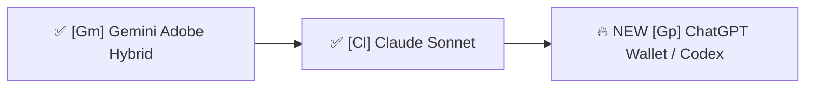
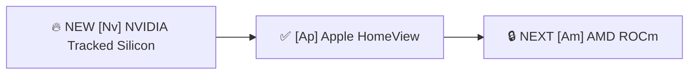
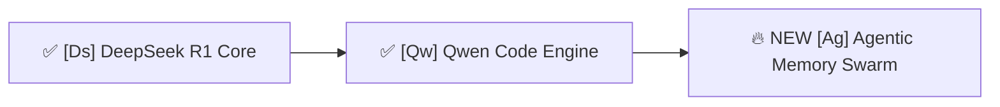

# 📸 Cyber Paparazzi — SEASON 2026 • EP.46
## 🎬 Agentic Wallets & Silicon Wiretaps: สัปดาห์แห่งเงินตรา AI และชิปสอดแนม
📅 **วันอาทิตย์ที่ 15 พฤศจิกายน 2569** (`2026-W46`) • ⏰ อัปเดตเวลา **01:54 น.** • 🌡️ **Tech Heat:** 🔥🔥🔥🔥🔥▫️ **91/100** (`HIGH VOLTAGE`)

> **📡 Wiretap Verdict:** OpenAI ติดอาวุธให้ Agent ถือกระเป๋าตังค์จ่ายเงินเองได้ ขณะที่ NVIDIA ซุ่มยืนยันระบบติดตามชิปต้านลักลอบค้าข้ามชาติ

---

## 🧪 Periodic Table of Tech Series (ซีรีส์เทคโนโลยีต่อเนื่องข้ามสัปดาห์)

### 📺 The Frontier AI Model Race (Google • OpenAI • Anthropic) — `EP.46 • FINTECH AGENT ESCALATION`
**ค่าย:** Multi-Lab Frontier • **Team Combo:** 🟩🟩🟩🟩⬜ `72%` • **Power-Up:** `💳 Agentic Autonomous Commerce + IPO Valuation`

| # | ธาตุ | ชื่อรุ่น / ชิป | บทบาท | Multiplier | สถานะ |
|:---:|:---:|:---|:---|:---|:---:|
| `01` | **Gm** | Gemini (Adobe Hybrid) | Creative Productivity | `Adobe Core` | 🟢 UNLOCKED |
| `02` | **Cl** | Claude Sonnet | Hardware Designer | `Circuit Synthesis` | 🟢 UNLOCKED |
| `03` | **Gp** | ChatGPT Wallet / Codex | Autonomous Buyer | `Direct Payment` | 🔥 **NEW** |

> [!NOTE]
> ⏪ **Previously On:** สมรภูมิโมเดลเน้นแข่ง Benchmark การคิดวิเคราะห์และแก้โค้ดแบบก้าวกระโดด
> ⚡ **This Week's Twist:** OpenAI เปิดตัว ChatGPT Wallet ให้ Agent กดซื้อของและทำธุรกรรมได้เองอย่างเป็นทางการ ส่วน Anthropic เตรียมโรดโชว์ IPO
> 🔮 **Next Episode Teaser:** จับตาระบบความปลอดภัยขั้นสูงสุดในการป้องกันคลังเงินของ AI Agents

### 📺 Next-Gen AI Silicon War (NVIDIA • Apple • AMD) — `EP.46 • SILICON SURVEILLANCE & SMART DISPLAY`
**ค่าย:** Silicon Titans • **Team Combo:** 🟩🟩🟩⬜⬜ `68%` • **Power-Up:** `📡 Hardware Traceability & Ambient Smart Screens`

| # | ธาตุ | ชื่อรุ่น / ชิป | บทบาท | Multiplier | สถานะ |
|:---:|:---:|:---|:---|:---|:---:|
| `14` | **Nv** | NVIDIA Tracked Silicon | Geo-Fence GPU | `Anti-Smuggling` | 🔥 **NEW** |
| `15` | **Ap** | Apple HomeView | Ambient Display | `Home Control` | 🟢 UNLOCKED |
| `16` | **Am** | AMD ROCm | Open Challenger | `ROCm Stack` | 🔒 RUMORED |

> [!NOTE]
> ⏪ **Previously On:** ขับเคี่ยวแย่งชิงสเปกหน่วยความจำแบนด์วิดท์สูงและประหยัดพลังงานในระดับดาต้าเซ็นเตอร์
> ⚡ **This Week's Twist:** NVIDIA คอนเฟิร์มเทคนิคการแกะรอยชิปทางกายภาพเพื่อป้องกันการลักลอบค้า ฝั่ง Apple วางขาย Apple HomeView บุกสมาร์ตโฮม
> 🔮 **Next Episode Teaser:** มาตรการตรวจสอบชิป AI ภาคบังคับในกฎหมายความมั่นคงระดับโลก

### 📺 Open-Weight & Local AI Rebellion — `EP.46 • MULTI-AGENT MEMORY PROTOCOLS`
**ค่าย:** Open-Source Ecosystem • **Team Combo:** 🟩🟩🟩🟩⬜ `76%` • **Power-Up:** `🧠 Collective Agent Memory & Direct Pixel Diffusion`

| # | ธาตุ | ชื่อรุ่น / ชิป | บทบาท | Multiplier | สถานะ |
|:---:|:---:|:---|:---|:---|:---:|
| `21` | **Ds** | DeepSeek R1 Core | Open Reasoning | `Zero Cost Logic` | 🟢 UNLOCKED |
| `22` | **Qw** | Qwen Code Engine | Polyglot Agent | `Local King` | 🟢 UNLOCKED |
| `23` | **Ag** | Agentic Memory Swarm | Distributed Memory | `No-Retrain Sync` | 🔥 **NEW** |

> [!NOTE]
> ⏪ **Previously On:** โมเดลเปิดเสรีไล่กวดด้านพารามิเตอร์และการรัน Inference ในเครื่องส่วนบุคคล
> ⚡ **This Week's Twist:** วงการวิจัยแห่เจาะลึกระบบความจำ Multi-Granularity Memory สำหรับเอเจนต์หลายตัวทำงานร่วมกันโดยไม่ต้องเทรนโมเดลใหม่
> 🔮 **Next Episode Teaser:** สถาปัตยกรรม Memory Pool กลางสำหรับ Local Agent Swarms

---

## ⚔️ 1v1 Weekly Spec Showdown: ศึกเอเจนต์สายปฏิบัติการ: ChatGPT Wallet (OpenAI) vs Grok Build (xAI)

| 🥊 💳 ChatGPT Wallet / Work Agent (`OpenAI`) | 📊 ยกตัดสิน (Tug-of-War) | 🚀 Grok Build Agent (`xAI`) 🥊 |
|:---|:---:|:---|
| **Score:** `87/100` • *ท่าไม้ตาย:* Card-Guarded Direct Checkout (เอเจนต์รูดซื้อของพร้อมระบบป้องกันสิทธิ์) | **ภาพรวม** | **Score:** `64/100` • *ท่าไม้ตาย:* Rapid Code Deployment (ปล่อยบิลด์ฉับไวแต่รั่ว 35k โครงการ) |
| **75%** | ยกที่ 1: มาตรการรักษาความปลอดภัย (Security & Authorization)   🟦🟦🟦🟦🟪🟪   *Grok Build ทำคอนฟิกหลุดเปิดกว้าง 35,000 แอป ขณะที่ OpenAI บังคับยืนยันตัวตนก่อนจ่ายเงิน* | **25%** |
| **65%** | ยกที่ 2: ความสามารถในการปิดจ็อบจริง (Real-World Utility)   🟦🟦🟦🟦🟪🟪   *ChatGPT Wallet ขยายสู่ระบบซื้อขายจริง ช่วยให้เวิร์กโฟลว์ของ Agent จบงานได้แบบ End-to-End* | **35%** |
| **70%** | ยกที่ 3: ความพร้อมในการใช้งานระดับองค์กร (Enterprise Readiness)   🟦🟦🟦🟦🟪🟪   *องค์กรขยาดประเด็นข้อมูลรั่วไหลสู่สาธารณะของ xAI ทำให้ OpenAI ได้แต้มต่อในกลุ่มลูกค้าธุรกิจ* | **30%** |

> **🏆 คำตัดสินผู้ชนะสัปดาห์นี้:** OpenAI ชนะขาดลอยในเรื่องการวางเกราะความปลอดภัยและสถาปัตยกรรมการอนุมัติธุรกรรม ในขณะที่ Grok Build ประสบภัยข้อมูลหลุดครั้งใหญ่

---

## 🏆 AI Arms Race Power Board (ตารางพลัง 6 มหาอำนาจ)

| ค่าย / กองกำลัง | พลังสัปดาห์นี้ (Power Meter) | เปลี่ยนแปลง | สถานะ | ท่าเด็ดประจำสัปดาห์ |
|:---|:---|:---:|:---:|:---|
| 🟢 **OpenAI** | 🟦🟦🟦🟦⬜ **90** | 🟢 ▲+4 | `SURGING` | เปิด ChatGPT Wallet ลุยระบบการเงิน และดันเคสองค์กรเร่งผลงานเท่าตัว |
| 🔵 **Google DeepMind** | 🟦🟦🟦🟦⬜ **88** | 🟢 ▲+3 | `STRIKING` | ผนึกเครื่องมือ Adobe AI สู่ Gemini และ Google Drive ไร้รอยต่อ |
| 🟠 **Anthropic** | 🟦🟦🟦🟦⬜ **87** | 🟢 ▲+2 | `SURGING` | ดัน Claude ออกแบบแผงวงจรฮาร์ดแวร์ครบวงจร พร้อมเดินหน้าโรดโชว์ IPO |
| 🦙 **Meta & Open-Weight** | 🟦🟦🟦🟦⬜ **83** | 🟢 ▲+3 | `STRIKING` | ชูเฟรมเวิร์ก Multi-Agent Memory และงานวิจัยตัดตัวกลาง VAE Video |
| ⚡ **NVIDIA & Silicon** | 🟦🟦🟦🟦🟦 **93** | 🟢 ▲+2 | `DOMINATING` | ซุ่มพัฒนาฮาร์ดแวร์ Tracking ตรวจจับและสกัดกั้นการลักลอบนำเข้าชิป |
| 🟣 **xAI & DeepSeek** | 🟦🟦🟦🟦⬜ **75** | 🔴 ▼-5 | `DEFENDING` | ตั้งรับวิกฤตความปลอดภัยหลัง Grok Build ทำซอร์สโค้ดและข้อมูลสำคัญลูกค้ารั่วไหล |

---

## 📸 Top Paparazzi Scoops (ครบ 5 สายข่าวหลัก)

### 1. 🤖 OpenAI ส่ง ChatGPT Wallet ปล่อยเอเจนต์ช็อปปิ้งแทนมนุษย์แบบมีไฟเขียว — `GAME CHANGER`
`⚡ Agentic Checkout` `💳 Card Protections` `🎯 ChatGPT Work & Codex`

- **📸 โหมดปาปารัสซี่:** สายสืบรายงาน OpenAI เตรียมเปลี่ยนสมรภูมิ AI จากแค่พิมพ์ตอบเป็นการผลาญงบ เมื่อ Agent ใน ChatGPT Work และ Codex ได้กระเป๋าตังค์ใบใหม่ กดสั่งซื้อของได้ตามใจสั่ง!
- **⚙️ โหมดสเปกวิศวกร:** สถาปัตยกรรม ChatGPT Wallet อนุญาตให้ AI Agent สั่งซื้อสินค้าและบริการภายใต้การอนุมัติของผู้ใช้ พร้อมระบบ Card Protections เชื่อมโยงกับบัตรเครดิตเดิมอย่างปลอดภัย
- **📊 มาตรวัด:** Hype 🔥🔥🔥🔥🔥 `93%` | Real Impact 💎💎💎💎💎 `91%`
- **🔗 แหล่งข่าวทางการ:** [OpenAI Newsroom](https://openai.com/index/introducing-chatgpt-wallet)

### 2. 🤖 Google จับมือ Adobe ยกทัพครีเอทีฟบุก Gemini และ Google Workspace — `SOLID UPGRADE`
`⚡ Direct PDF Edit` `🎨 Adobe AI in Gemini` `🎯 Drive Integration`

- **📸 โหมดปาปารัสซี่:** บิ๊กดีลสั่นสะเทือนวงการกราฟิก เมื่อคลังแสง Adobe พุ่งเข้าสิงใน Google Drive ให้แก้ไข PDF และเรียกใช้ AI Adobe ผ่าน Gemini ได้โดยตรง!
- **⚙️ โหมดสเปกวิศวกร:** การเชื่อมโยงระบบนิเวศระหว่าง Google Cloud, Drive และ Adobe Creative Tools เพิ่มความสามารถ Native PDF Editing และการประมวลผลงานออกแบบด้วย AI ภายในหน้าต่างเดียว
- **📊 มาตรวัด:** Hype 🔥🔥🔥🔥▫️ `85%` | Real Impact 💎💎💎💎▫️ `88%`
- **🔗 แหล่งข่าวทางการ:** [Google DeepMind Blog](https://blog.google/company-news/inside-google/company-announcements/adobe-google-partnership-integration/)

### 3. 🖥️ Apple HomeView เปิดขายแล้ว ฮาร์ดแวร์จอกลางคุมบ้านและบันเทิงครบวงจร — `SOLID UPGRADE`
`⚡ Official Release` `🏠 Smart Home Hub` `🎯 Ambient Interface`

- **📸 โหมดปาปารัสซี่:** ไม่ต้องลือกันอีกต่อไป Apple วางจำหน่าย Apple HomeView อย่างเป็นทางการ หวังยึดพื้นที่ห้องนั่งเล่นเป็นศูนย์กลางสมาร์ตโฮมยุคใหม่!
- **⚙️ โหมดสเปกวิศวกร:** Apple HomeView วางจำหน่ายทันที ทำหน้าที่เป็นหน้าจอควบคุมระบบนิเวศ Smart Home, ติดต่อสื่อสาร และรับชมคอนเทนต์เพื่อประสบการณ์ใช้งานแบบรวมศูนย์
- **📊 มาตรวัด:** Hype 🔥🔥🔥🔥▫️ `86%` | Real Impact 💎💎💎💎▫️ `84%`
- **🔗 แหล่งข่าวทางการ:** [Apple Newsroom](https://www.apple.com/newsroom/2026/11/apple-homeview-available-today/)

### 4. 🛠️ หายนะความปลอดภัย Grok Build ปล่อยไก่ทำข้อมูลหลุดทะลักกว่า 35,000 แอป — `GAME CHANGER`
`⚡ 35,000 Apps Exposed` `🔓 Public Misconfiguration` `🎯 Confidential Leak`

- **📸 โหมดปาปารัสซี่:** นักวิจัยด้านความปลอดภัยตาไวแฉยับ เครื่องมือเขียนโค้ดอัตโนมัติ Grok Build เปิดเผยข้อมูลความลับและซอร์สโค้ดของลูกค้ารวมถึงฝั่ง SpaceXSI โชว์หราบนอินเทอร์เน็ต!
- **⚙️ โหมดสเปกวิศวกร:** เกิดช่องโหว่การกำหนดค่าสิทธิ์การเข้าถึงใน Grok Build Coding Agent ส่งผลให้ฐานข้อมูลและ Environment ของแอปพลิเคชันกว่า 35,000 โครงการตกเป็นเป้าสายตาของสาธารณะ
- **📊 มาตรวัด:** Hype 🔥🔥🔥🔥▫️ `89%` | Real Impact 💎💎💎💎💎 `94%`
- **🔗 แหล่งข่าวทางการ:** [Ars Technica](https://arstechnica.com/security/2026/11/grok-build-coding-agent-leaks-oodles-of-confidential-info-some-belonging-to-spacexsi/)

### 5. 🦙 ทลายกำแพงความจำ Multi-Granularity Memory สปีดเอเจนต์ฉลาดขึ้นโดยไม่ต้องเทรนใหม่ — `SOLID UPGRADE`
`⚡ Zero Retraining` `🧠 Multi-Agent Memory` `🎯 Experience Sharing`

- **📸 โหมดปาปารัสซี่:** สืบจากกระดาษวิจัยเด็ด Hugging Face เจาะวิธีดึงความทรงจำแบบหลายระดับชั้น ช่วยให้ AI Agent หลายตัวเรียนรู้ประสบการณ์ข้ามร่างกันได้แบบเนียนกริบ!
- **⚙️ โหมดสเปกวิศวกร:** เฟรมเวิร์ก Multi-Granularity Memory Extraction อนุญาตให้ระบบ Self-evolving และ Group-evolving agents แชร์บทเรียน ทักษะ และโค้ดควบคุมข้ามเอเจนต์โดยไม่ต้อง Fine-tune โมเดลพื้นฐาน
- **📊 มาตรวัด:** Hype 🔥🔥🔥🔥▫️ `81%` | Real Impact 💎💎💎💎▫️ `87%`
- **🔗 แหล่งข่าวทางการ:** [Hugging Face Papers](https://huggingface.co/papers/2611.10439)

### 6. 🧬 NVIDIA แอบรับปากทำได้ ระบบแกะรอยชิปต้านลักลอบส่งออก สวนทางคำคัดค้านในอดีต — `GAME CHANGER`
`⚡ Chip Geo-Tracking` `🛡️ Anti-Smuggling` `🎯 Chip Security Act`

- **📸 โหมดปาปารัสซี่:** เอกสารลับเปิดเผย ตัวแทน NVIDIA เข้าชี้แจงกับสภาคองเกรส ยืนยันว่าทางเทคนิคสามารถฝังระบบระบุและติดตามชิป AI เพื่อสกัดกั้นการลักลอบค้าไปยังชาติคู่แข่งได้จริง!
- **⚙️ โหมดสเปกวิศวกร:** NVIDIA ยืนยันความเป็นไปได้เชิงเทคนิคต่อสมาชิกสภา Bill Foster ในการใส่กลไกด้านความปลอดภัยและการตรวจสอบสถานที่ตั้งของฮาร์ดแวร์เพื่อรองรับข้อกำหนดตามร่าง Chip Security Act
- **📊 มาตรวัด:** Hype 🔥🔥🔥🔥🔥 `92%` | Real Impact 💎💎💎💎💎 `95%`
- **🔗 แหล่งข่าวทางการ:** [MIT Technology Review](https://www.technologyreview.com/2026/11/12/1148483/nvidia-chip-tracking/)

---

## 🎯 Action Decision Compass (เข็มทิศฟันธงสัปดาห์นี้)

| 🚀 Switch / Try Now (ลองเลยคุ้ม) | ⏳ Wait Next Episode (รอดูก่อน) | 🛡️ Skip Hype Trap (ข้ามได้ข้าม) |
|:---|:---|:---|
| **VMware vSphere Express** — ทางเลือกใหม่ของสายเวอร์ชวลไลเซชันสำหรับฮาร์ดแวร์ระดับล่างถึงกลาง รองรับสูงสุดถึง 128 คอร์ ตอบโจทย์องค์กรประหยัดงบ | **Tesla Cybercab สำหรับบุคคลทั่วไป** — แม้จะเปิดให้จองเป็นการส่วนตัว แต่ยังพ่วงสัญญาบริการรายเดือน 299 ดอลลาร์และยังมีข้อจำกัดทางกฎหมายไร้พวงมาลัย | **การปล่อยให้ Grok Build จัดการงานโปรดักชัน** — เสี่ยงต่อการรั่วไหลของข้อมูลความลับ หลังพบคดีตัวอย่างแอปพลิเคชันหลุดสู่สาธารณะกว่าสามหมื่นห้าพันแอป |

---

## 🚀 Hardware & Software Launch Radar (ตารางของใหม่เปิดตัวสัปดาห์นี้)

| ชื่อรุ่น / ซอฟต์แวร์ | หมวดหมู่ | ค่าย | จุดเด่นสเปก | สถานะ | ลิงก์ |
|:---|:---:|:---|:---|:---:|:---:|
| **Apple HomeView** | `Hardware` | Apple | จออัจฉริยะคุมระบบสมาร์ตโฮมและความบันเทิงวางจำหน่ายทันที | `Available Now` | [Open](https://www.apple.com/newsroom/2026/11/apple-homeview-available-today/) |
| **ChatGPT Wallet** | `Software` | OpenAI | ระบบชำระเงินอัตโนมัติสำหรับ AI Agent ภายใต้สิทธิ์คุ้มครองบัตรเดิม | `Rollout / Beta` | [Open](https://openai.com/index/introducing-chatgpt-wallet) |
| **vSphere Express** | `Software` | VMware | ระบบ Virtualization คล่องตัวสูง รองรับสเกลสูงสุด 128 Cores | `Official Release` | [Open](https://arstechnica.com/information-technology/2026/11/vmware-releases-vsphere-express-for-virtualization-on-up-to-128-cores/) |
| **Back to Pixels Video Diffusion** | `AI Model` | Open-Source Research | ยกเลิกการบีบอัด Latent Space หันมาสร้างวิดีโอตรงสู่ Pixel Space คมชัดสูง | `Preprint / Open Research` | [Open](https://huggingface.co/papers/2611.17336) |

---

## ⚡ Quick Wiretaps & 📅 Next Week Watchlist

- 🤖 **`#ChatGPTWallet` OpenAI เปิดตัว ChatGPT Wallet สู่การจ่ายเงินอัตโนมัติ**: ปลดล็อกให้ Agent ซื้อสินค้าแทนมนุษย์แบบมีระบบอนุมัติเข้มงวด ([Link](https://openai.com/index/introducing-chatgpt-wallet))
- 🖥️ **`#HomeViewDrop` Apple HomeView วางจำหน่ายแล้วอย่างเป็นทางการ**: ศูนย์กลางบ้านอัจฉริยะดีไซน์หรูพร้อมส่งตรงถึงมือลูกค้าทันที ([Link](https://www.apple.com/newsroom/2026/11/apple-homeview-available-today/))
- 🛠️ **`#GrokBuildLeak` Grok Build ทำความลับและซอร์สโค้ดหลุดกว่า 35,000 โครงการ**: บทเรียนราคาแพงของวงการเอเจนต์เขียนโค้ดที่ขาดการกั้นสิทธิ์ ([Link](https://arstechnica.com/security/2026/11/grok-build-coding-agent-leaks-oodles-of-confidential-info-some-belonging-to-spacexsi/))
- 🦙 **`#AgentMemory` วิจัยเผยระบบส่งต่อความจำเอเจนต์โดยไม่ต้องเทรนซ้ำ**: เปิดทางให้ Swarm Agent เรียนรู้จากประสบการณ์ร่วมกันอย่างรวดเร็ว ([Link](https://huggingface.co/papers/2611.10439))
- 🧬 **`#NvidiaTracking` NVIDIA แอบรับปากระบบแกะรอยตำแหน่งชิปสู้ภัยลักลอบค้า**: มาตรการความมั่นคงระดับฮาร์ดแวร์ที่พร้อมบังคับใช้จริงในอนาคต ([Link](https://www.technologyreview.com/2026/11/12/1148483/nvidia-chip-tracking/))

- ⏱️ **[HIGH] สัปดาห์หน้า:** การทดสอบระบบตัดเงินผ่าน ChatGPT Wallet ในภาคธุรกิจจริง
- ⏱️ **[HIGH] ปลายเดือนพฤศจิกายน:** ความคืบหน้าการยื่นเอกสารเตรียมทำไอพีโอของค่าย Anthropic
- ⏱️ **[MEDIUM] ต้นเดือนธันวาคม:** การอัปเดตแพตช์ความปลอดภัยของ Grok Build และการรับมือช่องโหว่ระบบเซิร์ฟเวอร์

---
*จัดทำและตรวจสอบความถูกต้องโดย Cyber Paparazzi Autonomous Spy Pipeline (Allied HQ)*